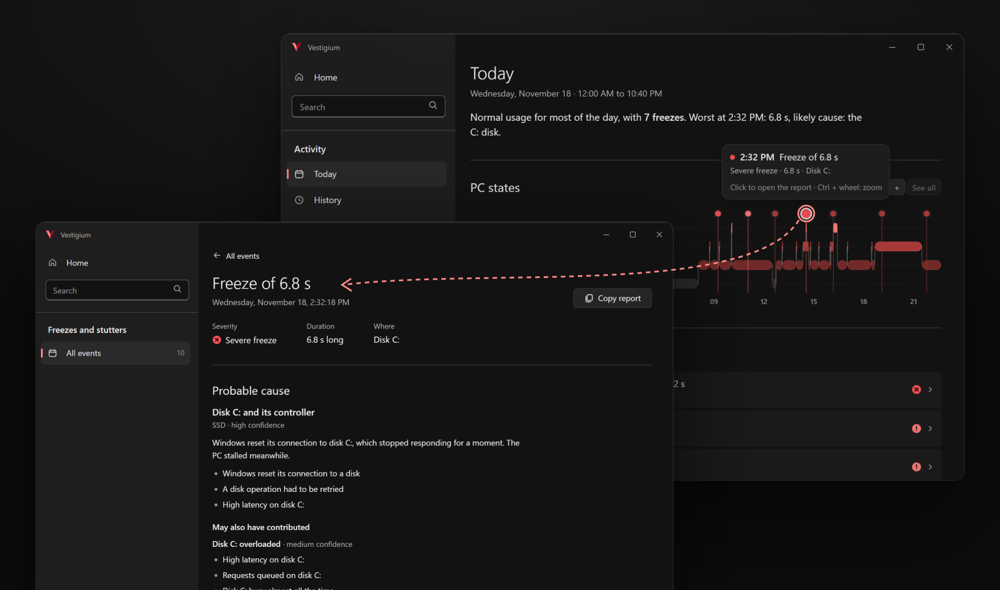

<p align="center">
  
</p>

<h1 align="center">Vestigium</h1>

<p align="center">
  <b>All-in-one freeze diagnostics for Windows PCs.</b>
</p>

<p align="center">
  <a href="https://github.com/Filipe-Soares-de-Almeida/Vestigium/actions/workflows/ci.yml"></a>
  <a href="https://github.com/Filipe-Soares-de-Almeida/Vestigium/releases/latest"></a>
  <a href="https://github.com/Filipe-Soares-de-Almeida/Vestigium/releases"></a>
  <a href="LICENSE"></a>
  
  
</p>

<p align="center">
  <picture>
    <source media="(prefers-color-scheme: light)" srcset=".github/assets/readme/hero-light.png">
    
  </picture>
</p>

https://github.com/user-attachments/assets/acbf9066-8e69-4845-bc70-5a5d37116181

---

Vestigium is a free, open-source app that finds out why a Windows PC freezes, stutters or crashes
with a blue screen (BSOD), and what to do about it. Each freeze becomes a report that names the
likely culprit and shows the evidence. It also reads the crash dumps Windows keeps, points to the
drivers behind high DPC latency, checks disks, memory and hardware, and suggests Windows settings
worth changing, each one reversible. A light agent monitors the PC from the tray, so the evidence is
there when the freeze is already gone.

It runs on Windows 10 22H2 and Windows 11 (x64), in English and Brazilian Portuguese, for anyone
chasing a freeze that is gone by the time Task Manager opens. It monitors the one PC it is installed
on.

## Highlights

- **Every freeze gets a report, with evidence.** It says when the PC stopped, for how long, what was
  running and which cause the readings point to: a disk reset, the graphics driver, low memory, an
  overloaded CPU, one app. When nothing matches, it says so.
- **The minutes before are already stored.** The agent keeps a rolling window of load, programs and
  Windows events, so a report shows what led up to the stop. A sensitive mode also catches the short
  stutters that break games, audio and calls.
- **Crash dumps, read for you.** Blue-screen and app crash dumps are explained on the PC, without the
  internet: the stop code in plain words and the driver most likely at fault.
- **The driver behind the lag.** A capture measures every driver's DPC/ISR latency and the frame
  times of the apps on screen, and names the driver or app behind the stutters.
- **Health checks, tests and reversible fixes.** It flags failing disks, hardware errors and a nearly
  full system drive, tests memory and disks, and suggests Windows settings to change, each undone in
  one click. A file system check that finds problems marks the volume, and Windows repairs it at the
  next restart. Security features stay as they are.
- **Light, local, no account.** The agent runs as your user and the window exits when it closes.
  Tasks that need administrator rights ask one at a time. No telemetry: besides the update check,
  which the window asks about first, the app makes no request. The installer downloads the WebView2
  runtime when it is missing, and an update downloads its installer after you confirm.

---

## Install

Download `Vestigium_<version>_x64-setup.exe` from the
[latest release](https://github.com/Filipe-Soares-de-Almeida/Vestigium/releases/latest) and run it. It
installs for every account on the PC, in `C:\Program Files\Vestigium`, after Windows asks for an
administrator's permission, and adds Vestigium to the Start menu. The monitor and the window then run as
your user.
[First run](../../wiki/First-run) covers the first minutes: starting the monitor, the tray icon and
the question about update checks.

> [!IMPORTANT]
> Vestigium is not code-signed yet. Windows may show "Windows protected your PC": check the download
> as below, then choose **More info** and **Run anyway**. On Windows 11 with Smart App Control turned
> on, Windows blocks apps that are not signed. [Windows security warnings](../../wiki/Windows-security-warnings)
> explains each warning.

<details>
<summary><b>Verify your download</b> — check the installer against the published hash</summary>

Each release lists the SHA-256 of its files in `SHA256SUMS.txt`. In PowerShell, in the folder that
holds the installer:

```powershell
Get-FileHash .\Vestigium_*_x64-setup.exe -Algorithm SHA256
```

The hash must match the installer's line in `SHA256SUMS.txt`, ignoring letter case. With the
[GitHub CLI](https://cli.github.com/), `gh attestation verify <installer> -R Filipe-Soares-de-Almeida/Vestigium`
confirms that this repository's release workflow built it.

</details>

---

## The window

"Open Vestigium" in the tray menu opens it. Home groups the screens by subject, and each subject
opens its own pages. Every screen follows Windows light or dark, in one of four colour themes, at the
detail level set in Settings: Simple, Detailed or Technical.

| Screen | What it does |
|---|---|
| [Activity](../../wiki/Activity) | The PC's states since midnight with every freeze and overload marked, the history of past days, and what weighs on the PC right now. |
| [Freeze reports](../../wiki/Freeze-reports) | The probable cause with its evidence, the steps to try, what happened second by second, and the minute before on a chart. **Copy report** puts it on the clipboard as Markdown. |
| [Health](../../wiki/Health) | The PC by area, checked every hour, with alerts that show whether they grew since they opened. |
| [Tests](../../wiki/Tests) | A memory test, SMART, a read-only surface scan, a file system check and a speed test for each disk. |
| [Optimizations](../../wiki/Optimizations) | Windows settings worth changing on this PC, each with the sign that suggested it and undone in one click. |
| [Dumps](../../wiki/Dumps) | The crash dumps Windows keeps, explained, and deleted once you confirm. |
| [Captures](../../wiki/Captures) | A measurement of every driver and app, from 2 minutes to 24 hours, that names what causes stutters. |
| [Settings](../../wiki/Settings) | Appearance, monitoring, data retention, language, updates, and privacy and data. |

## The tray

The Vestigium icon sits in the notification area. Its menu opens the window, pauses monitoring,
turns on sensitive mode for 30 minutes, starts Vestigium with Windows and exits. A badge on the icon tells the state by its shape,
and the tooltip says it in words: see [Tray icon](../../wiki/Tray-icon).

## Where the data lives

| Path | What it is |
|---|---|
| `%LOCALAPPDATA%\Vestigium\data` | The history, the settings, and the results of tests and captures. |
| `%LOCALAPPDATA%\app.vestigium` | The window's own files and the update-check preference. |

Settings › Privacy and data opens the folder and deletes the history after a confirmation.
[Privacy and data](../../wiki/Privacy-and-data) lists every file.

---

## Documentation

| Section | Pages |
|---|---|
| Getting started | [Installation](../../wiki/Installation) · [First run](../../wiki/First-run) · [Windows security warnings](../../wiki/Windows-security-warnings) · [Administrator prompts](../../wiki/Administrator-prompts) · [Updating](../../wiki/Updating) · [Uninstalling](../../wiki/Uninstalling) |
| Using Vestigium | [The window](../../wiki/The-window) · [Activity](../../wiki/Activity) · [Freeze reports](../../wiki/Freeze-reports) · [Health](../../wiki/Health) · [Tests](../../wiki/Tests) · [Optimizations](../../wiki/Optimizations) · [Dumps](../../wiki/Dumps) · [Captures](../../wiki/Captures) · [Settings](../../wiki/Settings) · [Tray icon](../../wiki/Tray-icon) |
| Help | [FAQ](../../wiki/FAQ) · [Troubleshooting](../../wiki/Troubleshooting) · [Reporting a problem](../../wiki/Reporting-a-problem) |
| Reference | [Privacy and data](../../wiki/Privacy-and-data) · [Glossary](../../wiki/Glossary) · [Changelog](CHANGELOG.md) |
| Contributing | [Contributing guide](.github/CONTRIBUTING.md) · [Code of conduct](.github/CODE_OF_CONDUCT.md) · [Security policy](.github/SECURITY.md) |

## Tested on

| System | Status |
|---|---|
| Windows 10 22H2, x64 | Tested |
| Windows 11, x64 | Not yet tested |

## License

Vestigium is released under the [MIT License](LICENSE). The installer also carries Intel's PresentMon,
under its own license, which is installed beside it.
